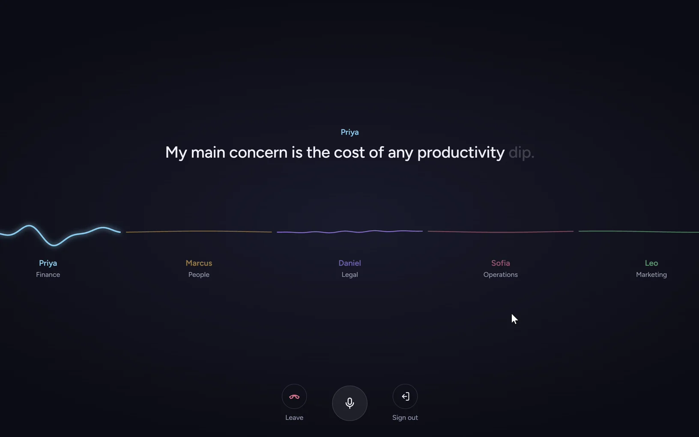
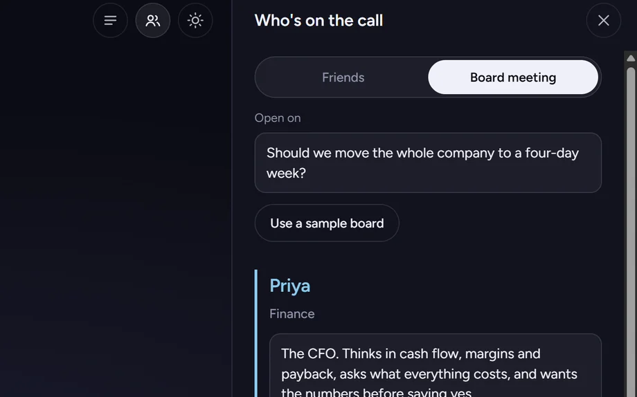
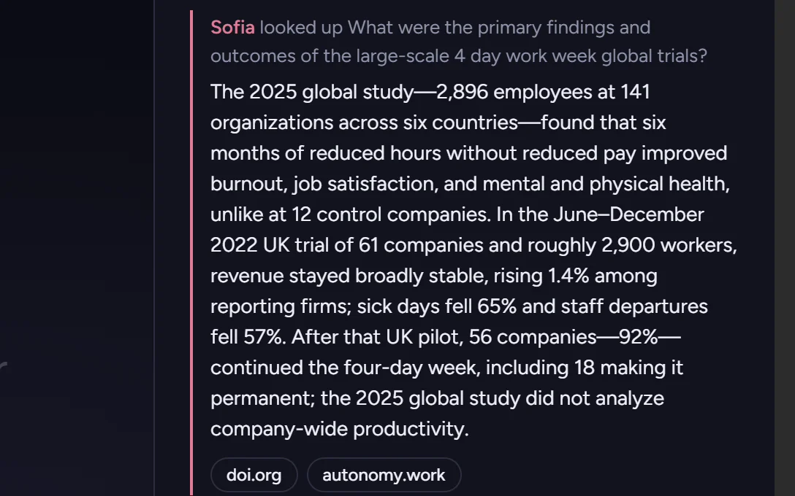
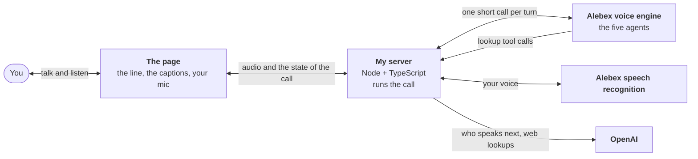

# Paradox

Five AI voices on one live call. Make them your own board of advisers, each with their own role (finance, people, legal, operations and marketing), or five friends talking about anything. They talk to each other, push back, cut in on each other and look things up with real sources, and you join in just by talking.

https://github.com/user-attachments/assets/f325d1da-7bd0-4ed5-9948-e5f944c50742

**[Watch the full demo (3 min)](https://behi22.github.io/meet-paradox/)** · [See the LinkedIn post](https://www.linkedin.com/feed/update/urn:li:activity:7531562268321308672/) · [Also see: Bex](https://github.com/behi22/meet-bex)

## Why I built it

[Bex](https://github.com/behi22/meet-bex) showed what one AI voice can do for you. I wanted to see what happens when several AI agents share one call, each with its own role and its own voice, talking to each other as much as to you. Picture a CEO with a board of AI advisers on call, finance, HR, legal and more, arguing a decision through before the real meeting. Paradox is a small, working showcase of that idea.

I built Paradox on my own, in my own time, on a regular Alebex developer account. It uses only the public developer docs and the same public APIs every developer gets, with no internal code or inside knowledge.

## What you can do

| Do this | What happens |
|---|---|
| Join the call | They start talking, on your question or one of their own |
| Just start talking | Whoever is speaking stops, and your words show as you say them |
| Say a name, or a role ("Legal, is that a risk?") | That person answers you |
| "Can someone check that?" | One of them looks it up on the web while the talk goes on. The finding and its sources land in the transcript |
| Change the subject | They go with it at once |
| Say nothing for five minutes | Someone checks you're still there. With no answer, they go quiet |

**Set it up your way:** a board meeting or a call between friends, the question to open on (or let them pick), and who the five are: a name, a role, a line on who they are, and one of twelve voices, each with a sample to hear.

| Your board of advisers | Setting it up | Every source, kept |
|---|---|---|
|  |  |  |

## In the full demo

A board meeting about a four-day week. Nothing is scripted: every line is said live.

| Time | What happens |
|---|---|
| 0:00 | Setting up the board |
| 0:10 | Sofia, from operations, opens on the question |
| 0:21 | Priya on cost, Daniel on contracts |
| 0:55 | "Priya, what would a pilot actually cost us?" |
| 1:15 | Leo on the talent pull, Marcus on burnout |
| 1:40 | "Legal, is there anything here that could get us in trouble?" |
| 2:02 | A lookup on what the big trials found, with real sources |
| 2:23 | Priya: "That sounds great on paper, but..." |
| 2:37 | "Let's run the pilot, Leo. How do we tell the team?" |
| 2:57 | The transcript, with every line and source |

## How it works

- **One short call per turn.** Each turn is its own call to the voice engine. While someone is speaking, the next speaker's call is already open and hearing the line, faster than it plays, so the answer is ready the moment the line ends.
- **The turn picker** reads each line as it starts and picks who would naturally speak next: someone whose area it touches, someone who was named, someone who has been quiet. It keeps track of the topic and what has been said, so nobody repeats it, and moves the talk on when it goes in circles.
- **You.** Your microphone is on while you're in the call. Your speech is recognised as you talk, a filter tells your voice apart from theirs, and once it's sure it's you, everyone stops and the person you spoke to hears exactly what you said.
- **Lookups** are a tool the agents call themselves. The search runs while the talk goes on, and whoever asked shares the finding on their next turn.

## The hard parts

- **Five voices, one at a time.** Every agent is a separate call. A room on one 20 ms clock mixes them, decides who may play, and feeds each listener the voice they are answering, so nobody talks over anybody unless they cut in on purpose.
- **Fast turns.** In a real conversation the gap between speakers is a fraction of a second. Starting the next call after a line ended took seconds. Opening it early and feeding it the line faster than real time brought the gap down to about a third of a second.
- **Telling you apart from them.** On speakers, their voices come back into your microphone. The filter checks what it hears against what they have said so far, so their echo never counts as you, while a few new words of yours stop them in about a second and a half.
- **Calls that end on their own.** The engine ends a call that goes quiet, and conversations have pauses. Keeping each turn to its own short call means nothing hangs up mid-conversation.
- **Lookups that never stall the call.** A web search takes seconds. The agent says it's checking and carries on, and the finding waits for their next turn, even if you cut that turn off first.
- **Lively, not chaotic.** Cut-ins are rare and timed to pauses, the same two never go back and forth for long, and when a topic runs dry, someone moves it on.

## By the numbers

- 259 automated tests
- Built in a week
- About a third of a second between speakers
- About three seconds from the end of your question to the answer
- Twelve voices to choose from

## Built with

TypeScript, Node.js, React, Vite and Vitest; the Alebex voice engine, agents API and speech recognition; and OpenAI models for picking turns and for web lookups. It runs on my own machine.

## About the code

The source stays private, because it runs on real keys. This repo is the showcase. If you want a walkthrough, [reach out on LinkedIn](https://www.linkedin.com/in/behbod-babai).
